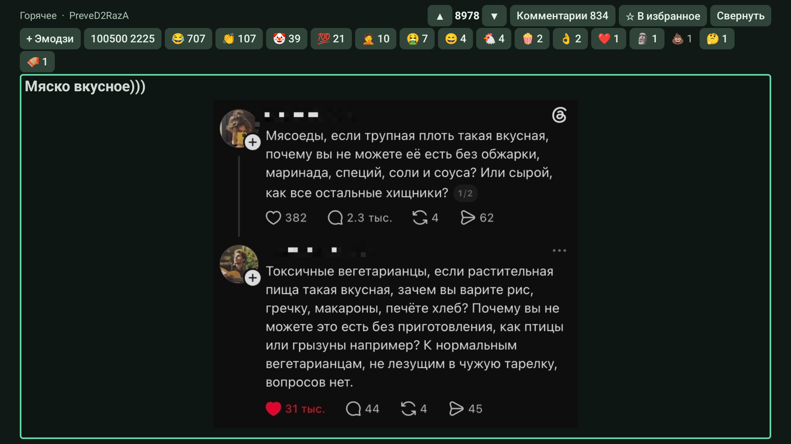
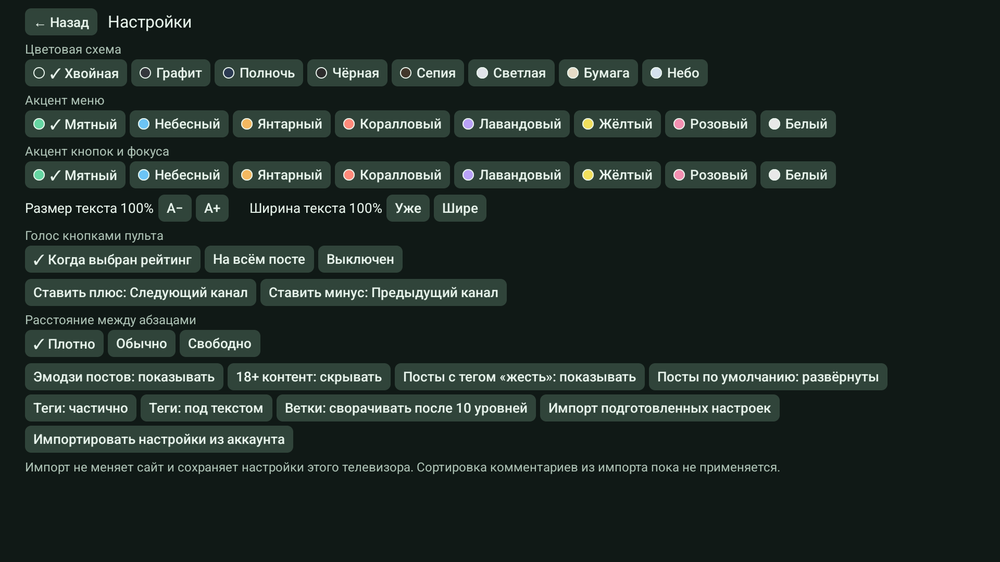
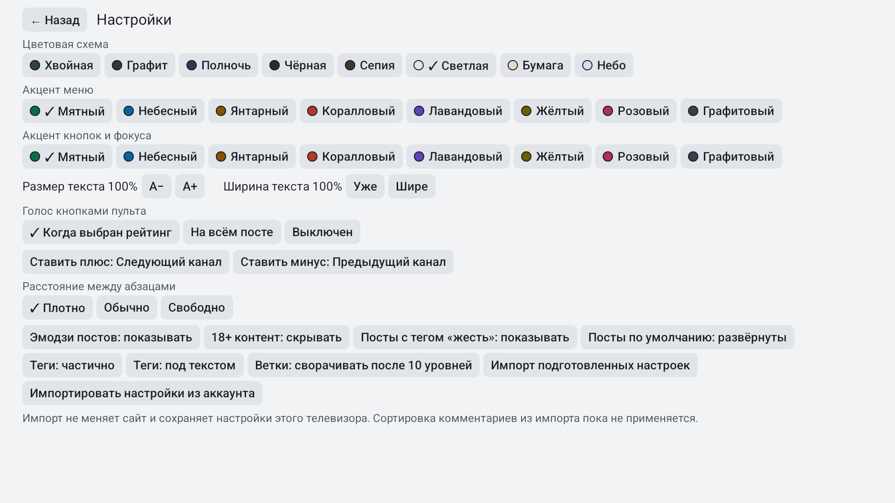

# PikaTV

Неофициальный клиент Pikabu для **Android TV и Google TV**. Лента, посты, комментарии и видео с обычного пульта, без рекламной оболочки сайта.

Текущая версия исходников — **0.4.3**. Первый APK-релиз готовится. [Руководство пользователя](docs/USER_GUIDE.md) · [Установка](docs/INSTALL.md) · [Поддержка](SUPPORT.md).

## Возможности

- «Горячее», «Лучшее», «Свежее» и персональные разделы через скрывающееся левое меню.
- Управление стрелками, OK и Back; размер текста 85–200%, ширина колонки, сворачивание постов и возврат к месту чтения.
- Изображения с увеличением и режимом по ширине.
- Комментарии прямо под постом, раскрытие и сворачивание веток.
- Голоса и эмодзи за посты и комментарии с немедленным отображением нажатия.
- Пять тёмных и три светлые темы, отдельные цвета меню и фокуса. По умолчанию — «Хвойная».
- Вход через Яндекс ID с QR-кодом или через форму сайта; импорт настроек отображения.
- Локальные избранное и история, доступные без входа.
- Встроенный нативный видеоплеер поверх чтения.

Публичные ленты доступны без аккаунта. Для подписок, списков сайта, голосов и реакций нужен вход. [Описание всех функций и ограничений](docs/USER_GUIDE.md).

## Тёмная и светлая темы

| Хвойная | Светлая |
| --- | --- |
|  |  |

## Документация

- [Подробное руководство со скриншотами](docs/USER_GUIDE.md).
- [Установка и обновление](docs/INSTALL.md).
- [Все пользовательские документы](docs/README.md).
- [Сообщить об ошибке](SUPPORT.md).

## Лицензии и данные

Оригинальный код проекта — [MIT](LICENSE). Сторонние компоненты сохраняют свои условия: [NOTICE](NOTICE.md), [лицензии](THIRD_PARTY_NOTICES.md).

PikaTV — независимый проект. [Отказ от гарантий](DISCLAIMER.md) · [Конфиденциальность](PRIVACY.md) · [Использование LLM](AI_DISCLOSURE.md) · [Безопасность](SECURITY.md).
