# PikaTV 0.4.4 — руководство пользователя

Версия приложения: **0.4.4**, код версии **15**. Документ обновлён 2 ноября 2026 года. [Установка](INSTALL.md) · [Все документы](README.md) · [Поддержка](../SUPPORT.md).

PikaTV показывает ленту, посты, изображения, комментарии и видео Pikabu в интерфейсе для телевизора. Для основного чтения достаточно стрелок, OK и Back. Мышь, сенсорный экран и специальные цветные кнопки не требуются.

Снимки основных экранов сделаны в 0.4.3, экранов лицензий — в 0.4.4; все — в гостевом режиме. Оформление основных экранов сохранено. [Галерея и источники контента](images/README.md). Содержание сайта, рейтинги и счётчики меняются со временем.

## Содержание

1. [Быстрый старт](#быстрый-старт)
2. [Разделы и меню](#разделы-и-меню)
3. [Управление пультом](#управление-пультом)
4. [Лента и чтение поста](#лента-и-чтение-поста)
5. [Изображения](#изображения)
6. [Комментарии](#комментарии)
7. [Голоса и эмодзи](#голоса-и-эмодзи)
8. [Тёмные и светлые темы](#тёмные-и-светлые-темы)
9. [Все настройки](#все-настройки)
10. [Аккаунт и импорт](#аккаунт-и-импорт)
11. [Избранное и история](#избранное-и-история)
12. [Видео](#видео)
13. [Ошибки и ограничения](#ошибки-и-ограничения)
14. [О приложении и лицензии](#о-приложении-и-лицензии)

## Быстрый старт

1. Установите подходящий APK по [инструкции](INSTALL.md). Первый APK-релиз готовится.
2. Откройте PikaTV из списка приложений телевизора. Приложение начинает с «Горячего» в тёмной схеме «Хвойная».
3. Перемещайтесь по постам кнопками ↑/↓. На выбранном посте нажмите OK для полного чтения.
4. Нажмите ← на карточке ленты или блоке поста: появится боковое меню. Выберите другой раздел и нажмите OK.
5. В «Настройках» подберите размер текста, ширину колонки и цветовую схему. Значения сохраняются на этом телевизоре.
6. При необходимости откройте «Аккаунт» и войдите самостоятельно. Гостевому чтению вход не нужен.

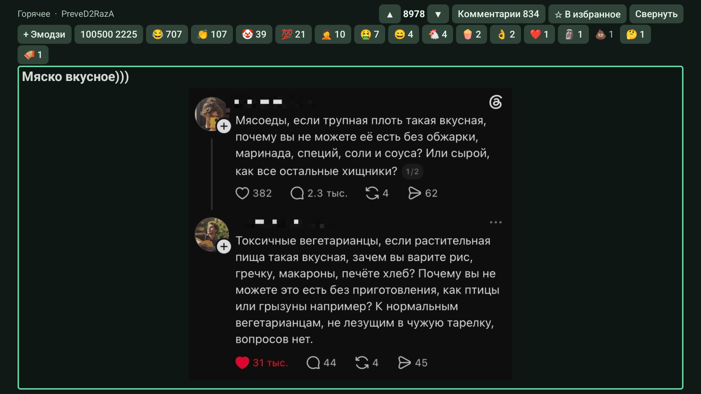

*Лента в тёмной схеме: строка действий, реакции и выделенная карточка поста. Обводка показывает текущий фокус.*

## Разделы и меню

Меню скрыто слева и появляется поверх контента. Постоянной верхней панели меню нет. В пустой ленте доступна отдельная кнопка «Меню».

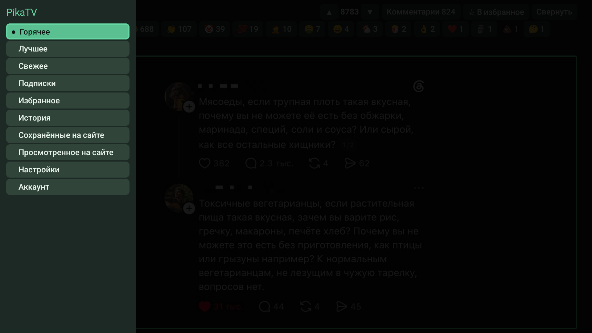

| Раздел | Назначение | Нужен вход |
| --- | --- | --- |
| Горячее | Основная публичная лента Pikabu | Нет |
| Лучшее | Публичная лента лучших постов | Нет |
| Свежее | Публичная лента новых постов | Нет |
| Подписки | Лента подписок аккаунта сайта | Да |
| Избранное | Посты, отмеченные звёздочкой на этом телевизоре | Нет |
| История | Последние открытые на этом телевизоре посты | Нет |
| Сохранённые на сайте | Чтение сохранённых постов аккаунта Pikabu | Да |
| Просмотренное на сайте | Чтение списка просмотренных постов на Pikabu | Да |
| Настройки | Оформление, чтение, пульт и импорт | Для местных настроек нет |
| Аккаунт | Вход, проверка сессии, импорт и выход | Открывается и без входа |

↑/↓ выбирают пункт меню. OK открывает его и скрывает меню. Back или → закрывают меню без выбора. Текущий раздел отмечен точкой. Если выбрать уже открытую ленту, она обновится с начала. Переключение между разными лентами сохраняет их отдельные позиции и выбранные посты, пока данные доступны.

Категории серверного сохранённого и игнор-лист ещё не подключены. Пункты «Избранное» и «Сохранённые на сайте» относятся к разным хранилищам.

## Управление пультом

| Где | Кнопка | Действие |
| --- | --- | --- |
| Лента | ↑/↓ | Предыдущий или следующий пост |
| Карточка ленты | OK | Открыть полный пост |
| Карточка ленты / блок поста | ← | Открыть боковое меню |
| Строка действий | ←/→, OK | Выбрать и выполнить действие; кнопки доступны и при переносе на несколько строк |
| Кнопки ленты | Back | Вернуть фокус на карточку |
| Карточка ленты | Back | Выйти из приложения с сохранением позиции |
| Полный пост | ↑/↓ | Читать блок, затем переходить к соседнему; длинный текст сначала прокручивается внутри блока |
| Полный пост | Back | Вернуться к ленте и прежнему посту |
| Комментарий | ← | Свернуть ветку; затем перейти к родителю |
| Комментарий | → | Раскрыть ветку или открыть ответы |
| Комментарий | OK | Перейти к действиям комментария |
| Действия комментария | Back | Вернуться к самому комментарию |
| Изображение | OK | Открыть панель масштаба |
| Изображение | Стрелки | Перемещать увеличенный кадр или читать длинную картинку по вертикали |
| Панель изображения | Back | Скрыть панель; следующий Back закрывает просмотрщик |
| Видео | Back | Закрыть плеер и вернуться к чтению |
| Форма входа | Back | Сначала вернуться к нативным кнопкам слева; затем закрыть окно |

Кнопки каналов и мультимедийные клавиши — дополнительные способы управления. Основные действия доступны без них.

Если выбранный элемент уже целиком виден, обычное перемещение фокуса не должно прокручивать экран. Небольшой сдвиг нужен только для показа следующего блока или комментария.

## Лента и чтение поста

Карточка показывает заголовок, автора, содержимое, рейтинг, число комментариев и доступные реакции. Кнопки «Комментарии», «В избранное» и «Свернуть» находятся рядом с рейтингом.

Короткий пост занимает свою высоту, ниже может быть виден следующий. Пост высотой от двух третей экрана получает весь доступный экран. Содержание ленты может быть сокращено: для полного текста, изображений и видео откройте пост кнопкой OK.

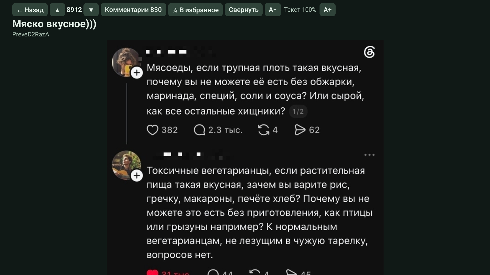

На экране поста:

- ↑/↓ перемещают фокус между блоками. В длинном текстовом блоке сначала дочитывается текст.
- ↑ от начала первого блока ведёт к «← Назад»; если теги стоят сверху, сначала выбираются они.
- «А−» и «А+» меняют масштаб текста. Изменение общее для чтения и сохраняется.
- «Свернуть» скрывает содержание конкретного поста; «Развернуть» возвращает его.
- Когда виден конец поста, комментарии загружаются автоматически и продолжают тот же список.
- Back возвращает к исходной карточке. Закрытие изображения или видео возвращает к блоку, из которого оно было открыто.

Позиция восстанавливается по посту и блоку, а не как обещание неизменного пикселя: удаление поста или изменение его структуры на сайте может повлиять на возврат.

Рекламная оболочка сайта не отображается. Адаптер также исключает подтверждённые рекламные и партнёрские публикации. Обычный закреплённый пост и значок Pikabu+ сами по себе не означают рекламу. Неразмеченное самопродвижение не всегда распознаётся автоматически.

## Изображения

Выберите изображение в полном посте или комментарии и нажмите OK. Оно откроется поверх чтения на чёрном фоне.

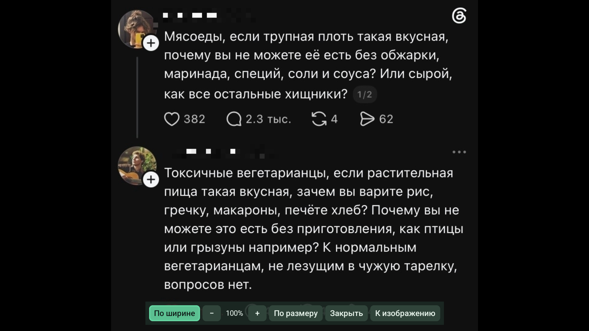

| Действие | Результат |
| --- | --- |
| OK на изображении | Показать панель |
| «По ширине» | Подогнать картинку по ширине; длинное изображение читать кнопками ↑/↓ |
| «Вписать» | Вернуться к изображению, вписанному в экран |
| «−» / «+» | В режиме вписывания менять масштаб от 100% до 400% |
| Стрелки при увеличении | Перемещать видимую область |
| «По размеру» | Вернуть масштаб 100% и исходное положение |
| «К изображению» | Скрыть панель и вернуть управление картинке |
| «Закрыть» | Вернуться к чтению |

Высокая картинка может сразу открыться по ширине. Если этот режим не загрузился, приложение попробует вписать изображение и покажет сообщение. Цвета фотографии не меняются при выборе темы приложения.

## Комментарии

Комментарии можно читать под постом либо открыть кнопкой «Комментарии N» в отдельном экране. Счётчик отражает сведения сайта и может отличаться от числа уже загруженных узлов.

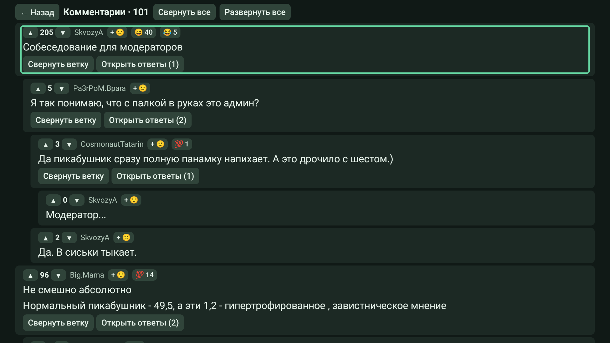

↑/↓ переходят по комментариям. ← сворачивает выбранную ветку, а повторное нажатие позволяет перейти к родителю. → раскрывает её или запрашивает ответы. На корневом комментарии ← не открывает главное меню.

OK переводит фокус внутрь комментария: к голосам, эмодзи и кнопкам ветки. Back возвращает его к самому комментарию. Изображения и видео в комментариях открываются так же, как в постах.

«Открыть ответы» догружает ответы конкретной ветки. «Ветка отдельно» позволяет сосредоточиться на обсуждении; «← Все комментарии» возвращает общий список. «Свернуть все» и «Развернуть все» меняют видимость веток, а не запускают бесконтрольную загрузку всего обсуждения.

Большие обсуждения загружаются порциями по мере чтения. Ошибка очередной порции не должна стирать уже показанные комментарии: используйте «Повторить». Глубина автоматического сворачивания настраивается отдельно.

Публиковать комментарии, отвечать текстом и модерировать обсуждения в 0.4.4 нельзя.

## Голоса и эмодзи

### Голоса

У постов и комментариев доступны ▲, рейтинг и ▼. Для отправки голоса нужна сессия Pikabu. Гостю предлагается войти.

1. Выберите ▲ или ▼ стрелками и нажмите OK.
2. Нажатие показывается сразу: плюс зелёный, минус красный. Цвет не зависит от акцента темы.
3. Повторное нажатие того же голоса снимает его. Противоположный голос заменяет прежний.
4. Пока запрос выполняется, повторная отправка блокируется. Если сайт откажет, индикация откатится и появится сообщение.

Ранее поставленный голос отображается нажатым при наличии актуальных данных сайта. В локальных копиях «Истории» и «Избранного» голоса и реакции недоступны до открытия поста и его загрузки из сети.

Дополнительно можно голосовать кнопками каналов: по умолчанию следующий канал — плюс, предыдущий — минус. В настройках выберите режим «Когда выбран рейтинг», «На всём посте» или «Выключен». Кнопки можно переназначить. Стрелки, OK, Back и Home для назначения недоступны: они нужны навигации.

### Эмодзи

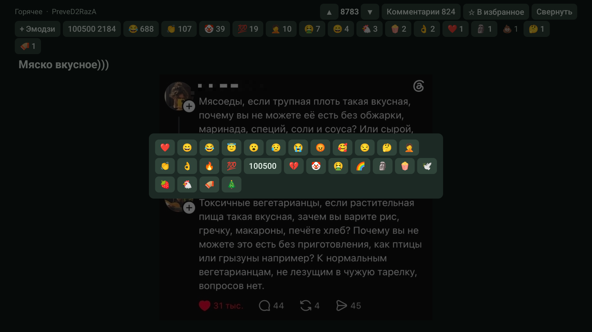

Реакции показаны со счётчиками. «+ Эмодзи» открывает выбор; в комментарии эта кнопка компактно обозначена «+ 🙂». OK на доступной реакции ставит её, повтор снимает, другая заменяет предыдущую. На один пост или комментарий у пользователя одна реакция.

Своя реакция выделена акцентом. Платные и модераторские варианты не предлагаются для новой покупки: приложение не расходует покупки пользователя. Значки отображаются близкими Unicode-эмодзи, поэтому рисунок может отличаться от сайта и между телевизорами.

Переключатель «Эмодзи постов» одновременно управляет отображением реакций постов и комментариев. У старых публикаций блок реакций может отсутствовать.

## Тёмные и светлые темы

По умолчанию включена **«Хвойная»** — тёмная схема для чтения вечером. Выбор не зависит от системной темы Android. Для дневного использования доступны светлые схемы. Тема применяется к ленте, посту, комментариям, меню, настройкам и окнам приложения, включая оформление формы входа.

### Тёмная схема

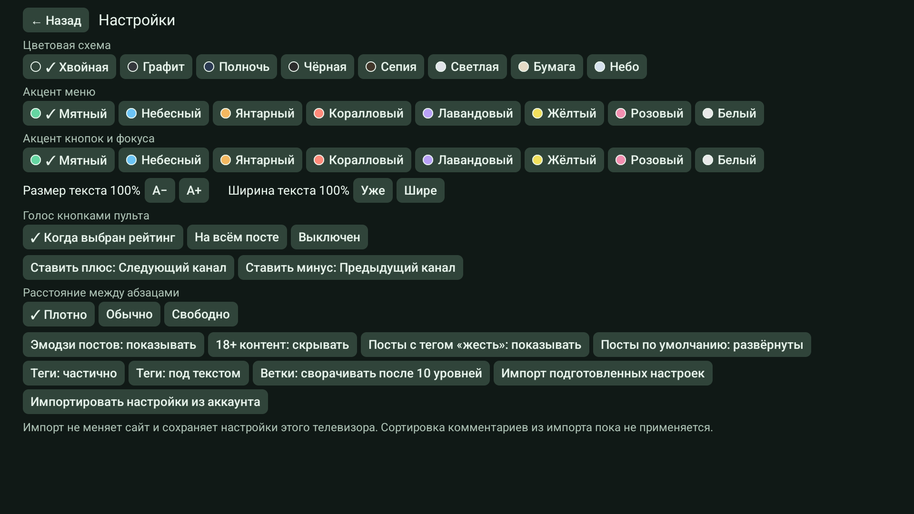

Тёмные варианты: **Хвойная, Графит, Полночь, Чёрная, Сепия**. Фоны приглушены, текст светлый. Выберите схему в «Настройки → Цветовая схема»; она сохраняется сразу.

### Светлая схема

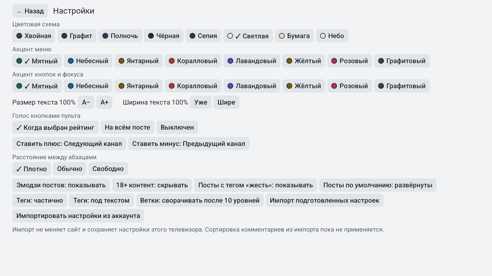

Светлые варианты: **Светлая, Бумага, Небо**. Для них используются более глубокие цвета акцента, чтобы кнопки и фокус оставались различимыми. Акцент «Белый» на светлом фоне называется «Графитовый».

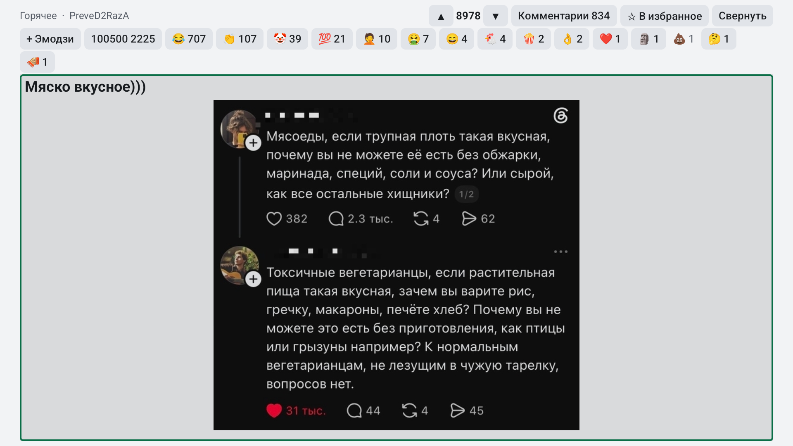

Сравните с [той же лентой в тёмной схеме](#быстрый-старт): меняется оформление интерфейса, а содержимое изображений остаётся исходным. Отдельно можно выбрать **акцент меню** и **акцент кнопок и фокуса**: мятный, небесный, янтарный, коралловый, лавандовый, жёлтый, розовый или белый/графитовый.

Тема приложения не регулирует подсветку телевизора. Яркость экрана меняется в настройках самого ТВ.

## Все настройки

Изменения применяются сразу, отдельной кнопки сохранения нет. ←/→ ходят в пределах ряда, ↑/↓ переходят к соседнему.

| Настройка | Варианты / действие | По умолчанию |
| --- | --- | --- |
| Цветовая схема | Пять тёмных и три светлых | Хвойная |
| Акцент меню | Восемь цветов | Мятный |
| Акцент кнопок и фокуса | Восемь цветов, независимо от меню | Мятный |
| Размер текста | «А−» / «А+», 85–200% | 100% |
| Ширина текста | «Уже» / «Шире», 40–100% | 100% |
| Голос кнопками пульта | На рейтинге / на всём посте / выключен | Когда выбран рейтинг |
| Ставить плюс / минус | Выбор собственной дополнительной кнопки; Back отменяет назначение | Следующий / предыдущий канал |
| Расстояние между абзацами | Плотно / обычно / свободно | Плотно |
| Эмодзи постов | Показать / скрыть реакции постов и комментариев | Показывать |
| 18+ контент | Показать / скрыть размеченные посты | Скрывать |
| Посты с тегом «жесть» | Показать / скрыть | Показывать |
| Посты по умолчанию | Развёрнуты / свёрнуты | Развёрнуты |
| Теги | Частично / скрыты / все | Частично |
| Положение тегов | Над текстом / под текстом | Под текстом |
| Сворачивание веток | Кнопка перебирает глубину 3, 5, 10; импорт может сохранить другое поддерживаемое значение | 10 уровней |
| Импорт подготовленных настроек | Применить встроенные базовые параметры чтения | Только по нажатию |
| Импортировать настройки из аккаунта | Прочитать поддерживаемые настройки сайта после входа | Только по нажатию |

Фильтры 18+ и «жесть» опираются на разметку сайта. Они не заменяют родительский контроль и не распознают содержимое картинки.

Во время чтения приложение удерживает экран включённым **30 минут после последнего нажатия**, включая меню и диалоги. После более долгого бездействия действуют обычные настройки заставки телевизора. Воспроизводящееся видео также удерживает экран.

## Аккаунт и импорт

Для подписок, серверных списков, голосов и реакций войдите именно в PikaTV. Вход в браузере компьютера не переносится на телевизор автоматически.

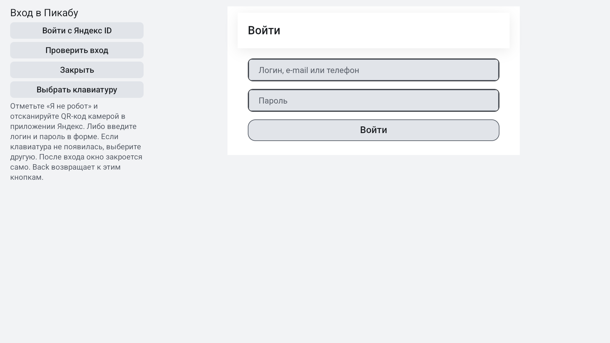

### Вход без ввода пароля на телевизоре

1. Откройте «Аккаунт → Войти в Пикабу».
2. Выберите «Войти с Яндекс ID».
3. Если Pikabu покажет «Пикапчу», пройдите её самостоятельно с пульта. Это проверка сайта перед переходом к Яндексу.
4. На странице Яндекс ID отсканируйте QR-код телефоном и подтвердите вход в своём аккаунте.
5. Дождитесь возврата в приложение. Если окно не закрылось автоматически, нажмите «Проверить вход».

QR-код относится к текущей попытке входа. Не публикуйте его и не отправляйте вместе со скриншотами ошибки. В документации показана пустая форма, без действующего QR-кода.

Запасной вариант — логин и пароль в штатной форме сайта. Если экранная клавиатура не появилась, нажмите «Выбрать клавиатуру»: системная клавиатура для ввода с телефона может не иметь собственного экрана. Back из страницы возвращает к кнопкам слева.

Приложение сохраняет собственную сессию через WebView. Отдельная кнопка выхода удаляет cookies приложения; она не удаляет аккаунт Pikabu и локальные историю, избранное или настройки. Подробнее — [конфиденциальность](../PRIVACY.md).

### Перенос настроек

Импорт запускается явно. Он читает только поддерживаемые настройки отображения и **не меняет настройки сайта**. Значения, которые вы уже явно выбрали на этом TV, имеют приоритет при повторном импорте. Цветовая схема, акценты, масштаб и ширина колонки относятся к этому телевизору.

Применяются, в частности, фильтры размеченного контента, сворачивание постов, показ и положение тегов, глубина веток. Сортировка комментариев сохраняется как импортированное значение, но пока не меняет их порядок. Автозапуск видео отключён политикой приложения. Настройки Tampermonkey/GM_config через аккаунт не переносятся.

Если сессия сайта истекла, может потребоваться повторный вход. Местные настройки и списки при этом сохраняются.

## Избранное и история

«☆ В избранное» сохраняет местную карточку; повторное нажатие «★ В избранном» убирает её. Серверное сохранённое Pikabu это действие не меняет.

«История» содержит до **100** последних открытых постов на этом телевизоре. Приложение также хранит ориентиры чтения до **300** постов. Эти данные доступны без входа и сохраняются после выхода из аккаунта.

Сохранённая карточка содержит сокращённое описание и ссылки на медиа. Это не полноценная загрузка поста для автономного чтения: полный текст и изображения могут требовать сети. Для актуальных голосов и реакций сначала откройте сам пост.

Локальные данные общие для установки приложения, а не раздельные профили для каждого входа. Удаление приложения или очистка его данных удалит их; экспорт и облачная синхронизация пока не предусмотрены.

## Видео

Рядом с кнопкой «▶ Видео» показывается доступное превью. Видео запускается только по действию пользователя и открывается во встроенном нативном плеере поверх чтения.

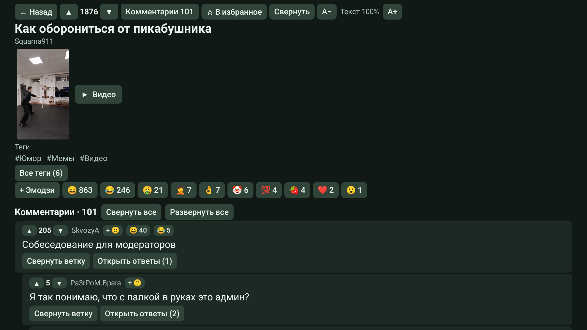

*Короткий пост с видео: превью рядом с кнопкой, теги и автоматически загруженные комментарии продолжают тот же экран.*

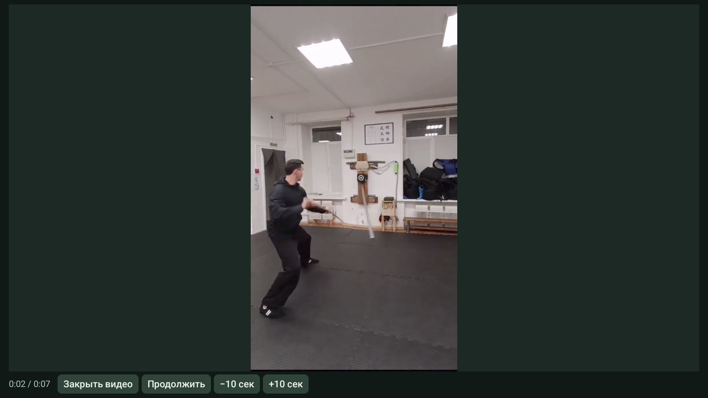

| Действие | Назначение |
| --- | --- |
| Пауза / Продолжить | Остановить или продолжить воспроизведение |
| −10 сек / +10 сек | Перейти назад или вперёд, если источник позволяет |
| Закрыть видео / Back | Вернуться к тому же месту чтения |
| Повторить видео | Повторить попытку после ошибки, если есть ссылка |
| Play/Pause, перемотка на пульте | Дополнительный способ управлять плеером |

При уходе с экрана приложения плеер приостанавливается и освобождает ресурсы в соответствии с жизненным циклом Android. Закрытое видео не должно продолжать звучать в фоне.

Базовая версия передаёт имеющуюся ссылку плееру. Страница внешнего хостинга может оказаться HTML вместо видеопотока; формат или кодек может не поддерживаться. Полный охват внешних хостингов, HLS/DASH и DRM не заявлен. При ошибке закройте плеер и продолжайте читать. Веб-плеер как запасной экран не открывается.

Приложение не добавляет рекламную оболочку плеера, но не анализирует рекламные кадры, уже встроенные в сам видеопоток.

## Ошибки и ограничения

| Ситуация | Что сделать |
| --- | --- |
| Лента не загрузилась | Проверьте интернет и нажмите «Повторить». Не считайте ошибку пустой лентой |
| Ошибка при догрузке | Повторите запрос; загруженные посты или комментарии должны оставаться на экране |
| Сайт требует вход | Откройте «Аккаунт» и проверьте сессию; гостевые ленты доступны отдельно |
| Поля входа очистились / капча не пройдена | Используйте встроенную форму, самостоятельно завершите проверку сайта; пароль в сообщение об ошибке не включайте |
| Клавиатура не появляется | Нажмите «Выбрать клавиатуру» в окне входа |
| Видео не воспроизводится | Попробуйте повтор, затем закройте плеер. Не всякая ссылка является поддерживаемым потоком |
| Не видно голосов в «Истории» | Откройте пост: местная копия не содержит актуальных прав и состояния голоса |
| После обновления APK не устанавливается | Проверьте совпадение пакета и подписи по [инструкции обновления](INSTALL.md) |
| Не отображается незнакомый тип блока | Возможна новая структура сайта; приложите версию и публичную ссылку в [сообщение об ошибке](../SUPPORT.md) |

В 0.4.4 не реализованы: публикация постов и комментариев, изменение подписок и серверного сохранённого, категории сохранённого, отдельный игнор-лист, поиск по сайту, календарь «Лучшего», полная поддержка внешних видеохостингов, перенос cookies с компьютера и облачная синхронизация местных данных.

Работа приложения зависит от доступности и структуры сайта. Наличие видеоссылки не гарантирует её воспроизведение на каждом устройстве.

## О приложении и лицензии

В конце «Настроек» откройте «О приложении и лицензии». Здесь показана версия и доступны полные тексты лицензий, уведомления библиотек, правила Public Suffix List, конфиденциальность и отказ от гарантий. Интернет для чтения этих документов не нужен.

↑/↓ выбирают документ, OK открывает его. Длинный текст читается стрелками; «Предыдущая страница» и «Следующая страница» переключают порции. Back возвращает к списку, следующий Back — к настройкам. Применяются выбранная тема и размер текста.

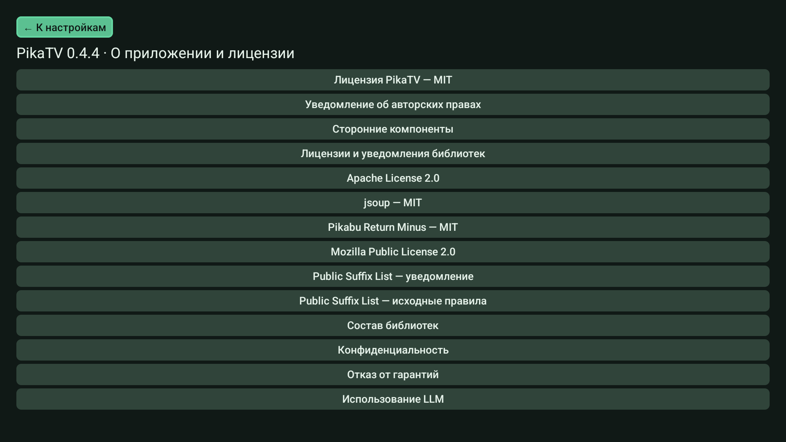

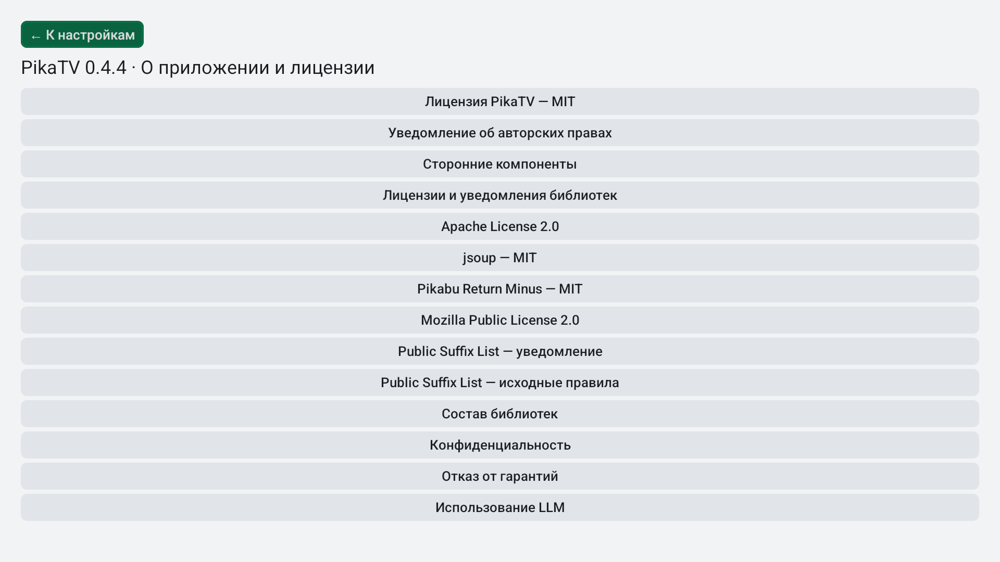
