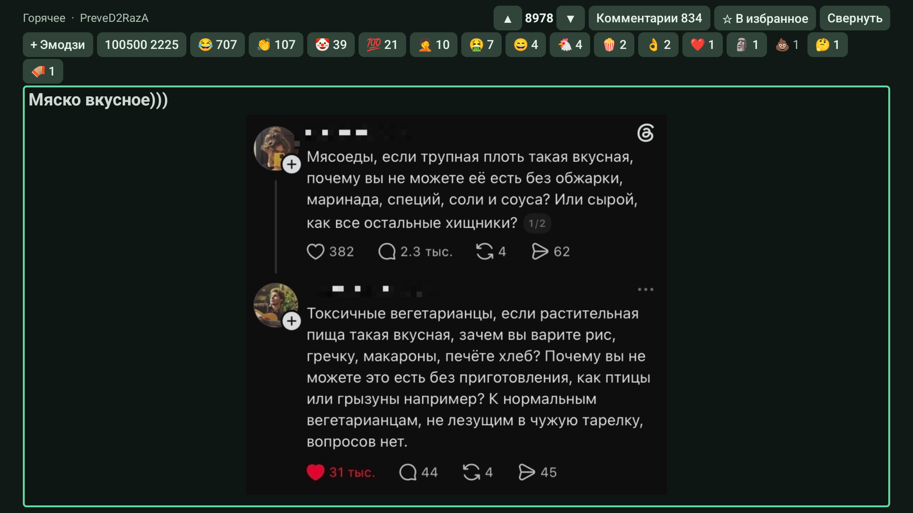
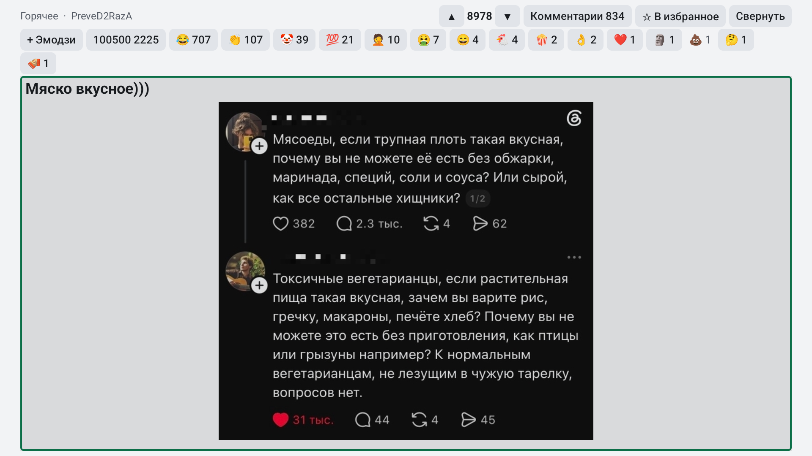
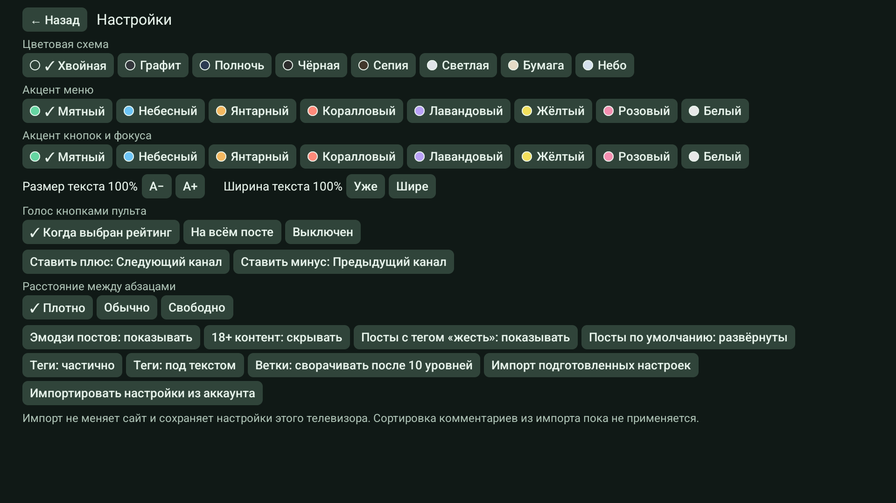
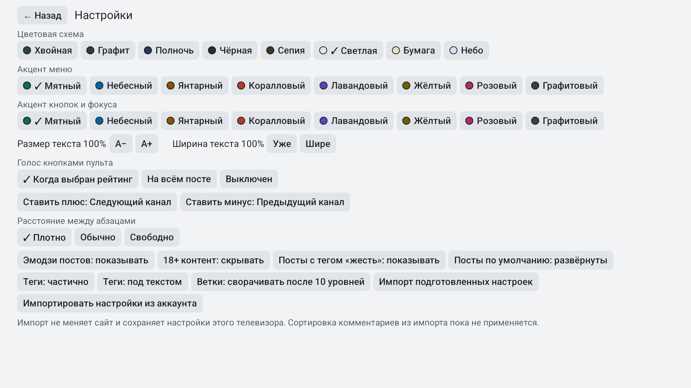

# Экраны PikaTV 0.4.3

Иллюстрации приложения в гостевом режиме. Показаны реальные экраны без перерисовки. Содержание публикаций и счётчики меняются со временем.

## Темы

| Хвойная | Светлая |
| --- | --- |
|  |  |
|  |  |

## Функции

| Экран | Иллюстрация |
| --- | --- |
| Боковое меню | [menu-dark.png](menu-dark.png) |
| Полный пост | [reader-dark.png](reader-dark.png) |
| Комментарии | [comments-dark.png](comments-dark.png) |
| Увеличение изображения | [image-dark.png](image-dark.png) |
| Выбор эмодзи | [reactions-dark.png](reactions-dark.png) |
| Вход | [login-light.png](login-light.png) |
| Видео в посте | [video-post-dark.png](video-post-dark.png) |
| Плеер | [player-dark.png](player-dark.png) |

На ленте, посте, изображении и окне реакций показана публикация [«Мяско вкусное)))»](https://pikabu.ru/story/_14481803), автор PreveD2RazA. На снимках комментариев и видео — [«Как оборониться от пикабушника»](https://pikabu.ru/story/_14482332), автор Squama911.

Посты, изображения, видео, комментарии, имена пользователей и знаки сервисов принадлежат их правообладателям. Иллюстрации служат объяснению интерфейса и не предоставляют на показанный контент лицензию MIT. [Руководство](../USER_GUIDE.md).
